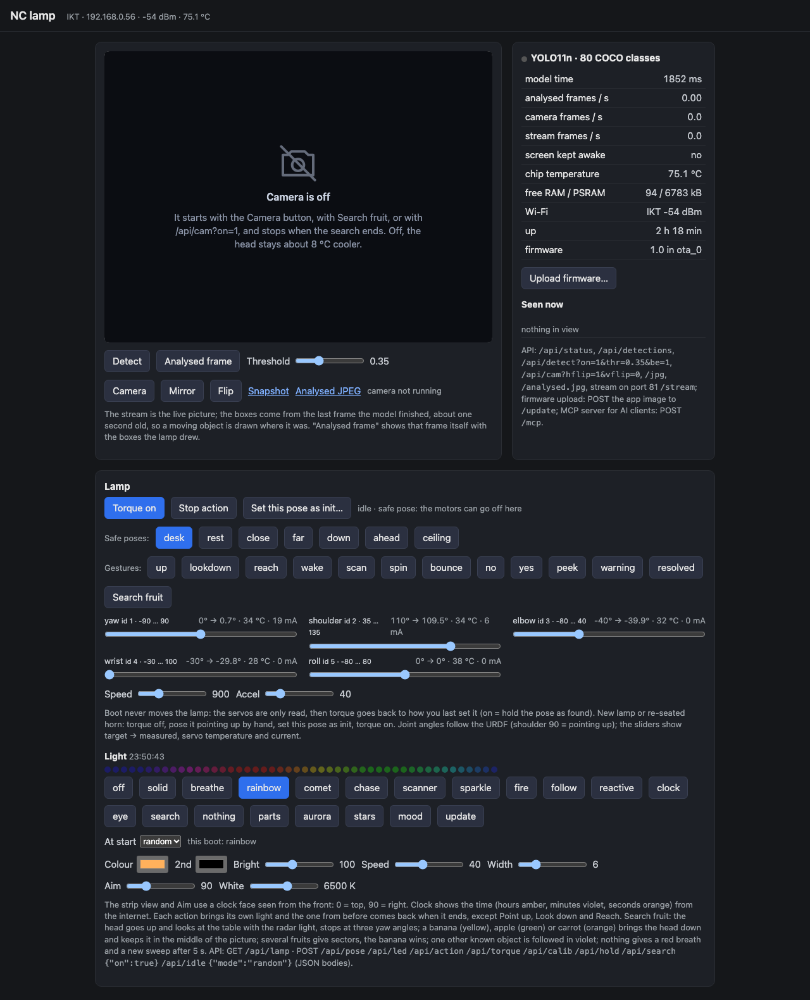

# Meet Lamp


<p>
  
</p>

A fully 3D-printed robotic desk lamp with 5 ST3215 bus servos: yaw in the base, shoulder, elbow, wrist and a head that rolls around its neck. 

## ✨ Why Lamp?

- 🖨️ **Fully 3D printed** - 17 parts in 12 shapes
- ⚙️ **5 DOF** on one serial bus - the same ST3215 servos as [ElRobot](../elrobot/)
- 💡 **Two ways to build it** - a simple version driven from your PC, or an LED version with a XIAO ESP32-S3 in the head, a WS2812B light ring, a web page and an MCP server for AI clients
- 📷 **Optional camera** - with the XIAO ESP32-S3 Sense the head runs a YOLO11n detector and can find and follow a fruit on your desk
- 💰 **Affordable** - ~$140 (simple) / ~$170 (LED version)

## 🚀 Quick Start

1. **[🖨️ Print](#️-3d-printing)** - Download the .3mf files and print the parts
2. **[🛒 Buy](#️-bill-of-materials-bom)** - 5 servos, an adapter, a power source, ballast bolts
3. **[🔧 Assemble](#-assembly)** - Set the motor IDs, build from the base up
4. **[🔌 Wire](#-electronics--wiring)** - Power and bus, plus the head electronics for the LED version
5. **[🎯 Init](#-first-start-and-init-pose)** - Put the arm straight, store the init pose, torque on
6. **[🎉 Enjoy](#-community)** - Join the community and show your build!

## 📋 Quick Specs

| | |
|---|---|
| **DOF** | 5 (yaw, shoulder, elbow, wrist, head roll) |
| **Links** | 130 mm upper arm and forearm, 110 mm shade |
| **Base** | Ø160 mm, ballast bolts inside |
| **Servos** | 5× ST3215 12 V on one bus, IDs 1 (base) to 5 (head) |
| **Weight** | ~1.2 kg lamp + ~0.6 kg ballast |
| **Estimated cost** | ~$140 simple / ~$170 LED version |

## 🔀 Two Versions

| | Simple version | LED version |
|---|---|---|
| Electronics | Seeed Studio Servo Adapter **in the base**, USB cable to your computer | XIAO ESP32-S3 + Seeed Studio Servo Adapter **in the head** |
| Light | none | WS2812B ring in the shade (~48 LEDs) |
| Control | from the PC over USB: any ST3215 / Feetech bus library, the NormaCore station | browser page over WiFi (sliders, gestures, safe poses, light looks), REST API, MCP server for AI clients, firmware updates over WiFi |
| Camera | none | optional: XIAO ESP32-S3 **Sense**, live stream, YOLO11n detector, fruit search example |
| Head plate to print | none | `plate_xiao_x1.stl` |
| Window disc | `window_disc_x1_PETG.stl` | `window_disc_x1_PETG.stl`, or `window_disc_cam_x1_PETG.stl` with the camera |
| Head cover to print | none | `cover_flat_x1.stl`, or `cover_xiao_x1.stl` with the camera |

Both versions share the same printed parts, servos and ballast. Only the electronics and the wiring differ.

> **No end stops.** The first motor (yaw, ID 1) and the last one (head roll, ID 5) have no mechanical end stops. Their travel is limited only by the servo cable loops and by the software limits. Do not force them past ±90° by hand, and keep the limits in the firmware config.

# 🛠️ Bill of Materials (BOM)

### Common parts (both versions)

| Part | Qty | Unit Cost | Links / Notes |
| :--- | :---: | :---: | :--- |
| **ST3215 Servo (12V/30kg)** | **5** | ~$22.00 | With horn, cable and screw bag. [SeeedStudio](https://www.seeedstudio.com/STS3215-30KG-Serial-Servo-p-6340.html) / AliExpress 6-pack: [Opt 1](https://aliexpress.com/item/1005009270126951.html) / [Opt 2](https://aliexpress.com/item/1005009339011602.html) |
| **Bus Servo Adapter (A)** | **1** | ~$5.99 | [Seeed Studio](https://www.seeedstudio.com/Bus-Servo-Driver-Board-for-XIAO-p-6413.html). Sits in the base (simple) or in the head (LED version) |
| **Power source, 12 V** | **1** | ~$8.00 | **Either** a 12 V / 5 A DC PSU (5.5×2.1 mm jack) **or** a USB Type-C PD trigger board set to 12 V with a PD charger of 60 W or more. See [Power](#power) |
| **Ballast: M16×70 hex bolts + M16 nuts** | 3 + 6 | ~$5.00 | Full-thread (DIN 933). Lie in three cradles on the bottom plate. ~585 g total. Other sets (M16×60, M14×80 ...) work too, aim for 500–600 g of steel |
| **USB-C data cable** | 1 | ~$5.00 |  |

Screws come from the servo bags: 44× M3×6 and 20× M2 self-tapping.

### LED version only

| Part | Qty | Unit Cost | Links / Notes |
| :--- | :---: | :---: | :--- |
| **Seeed Studio XIAO ESP32-S3 Sense** | **1** | ~$19.00 | The Sense model brings the camera (detector, fruit search). The plain XIAO ESP32-S3 does everything else |
| **WS2812B strip, 144 LED/m** | 333 mm | ~$5.00 | About 48 pixels, LEDs facing inwards in the mouth ring channel. 12 mm wide strip (10 mm works too) |
| **MP1584EN mini buck, 12 V → 5 V, 3 A** | **1** | ~$2.00 | Powers the strip. Set it to 5.0 V **before** connecting anything |
| **330 Ω resistor** | 1 | - | Optional, but better to have: In series with the strip data line |


### 📝 Hardware & Design Notes

* **Servo IDs:** every ST3215 ships with ID 1. Give them IDs **1 to 5, base to head**, one servo at a time, before assembling (see [Assembly](#-assembly)).
* **The camera is optional.** With a XIAO ESP32-S3 Sense and `CAM_ENABLED 1` in the firmware the lamp streams the picture, runs a YOLO11n detector and can find and follow a fruit on the desk. Print `window_disc_cam_x1_PETG` and `cover_xiao_x1` then; without a camera the plain disc and `cover_flat_x1`.
* **Current budget:** 5 servos idle take ~1 A at 12 V, a hard stall is 2.7 A each. 48 LEDs at full white take up to 2.9 A at 5 V.

---

# 🖨️ 3D Printing

- **Filament needed:** ~550 g PLA + 7 g transparent PETG for the window disc (~19 h total at 0.2 mm)
- **Settings:** 0.4 mm nozzle, 0.2 mm layers, 2 walls, 15 % infill, **use supports for critical regions only**

<p>
  
  
</p>

## For Bambulab / Orca Slicer Users

| Profile | Link | Note |
|---|---|---|
| Bambu A1, PLA parts | [.3mf](print/lamp-a1-pla.3mf) | Ready to print project |
| Bambu A1, PETG discs | [.3mf](print/lamp-a1-petg.3mf) | Both window discs, pick one |

**Before printing:**
- **Head plate:** print `plate_xiao_x1` for the LED version. The simple version needs no plate. 
- **Window disc:** print `window_disc_x1_PETG` (`window_disc_cam_x1_PETG` with the camera) in transparent PETG, 100 % infill, slow. Or buy a 110 mm 0.8mm height acrylic/PET disc.

## For Other Printers

STL files are in [`/STL`](./STL). They are exported in assembly orientation, so lay each part on the face listed below.

| File | Qty | Lay on | Note |
|---|---|---|---|
| `base_cup_x1.stl` | 1 | roof (upside down) | tallest base part |
| `base_bottom_x1.stl` | 1 | flat, cradles up | ballast cradles and screw counterbores |
| `turntable_tower_x1.stl` | 1 | disc down, pod up | |
| `pod_lid_x3.stl` | 3 | rim down | |
| `rear_plate_x3.stl` | 3 | outer face (4 holes) down | |
| `link_x2.stl` | 2 | skin down | hub disc, knuckle and pod skin all on the bed |
| `neck_x1.stl` | 1 | skin down | |
| `head_cap_x1.stl` | 1 | pad down, flange up | |
| `shade_x1.stl` | 1 | mouth down, cap up | 146 mm tall |
| `bezel_x1.stl` | 1 | lip down, skirt up | |
| `window_disc_x1_PETG.stl` | 1 | flat | transparent PETG, 0.6 mm, 100 % infill |
| `plate_xiao_x1.stl` | 1 | back face down, wall up | LED version only |
| `cover_flat_x1.stl` | 1 | | LED version only, no camera |
| `cover_xiao_x1.stl` | 1 | | LED version only, with camera |

---

## 🔧 Assembly

**You'll need:**
- PH1, PH2 screwdrivers
- Small flat screwdriver (buck trimmer), side cutters, soldering iron (LED version)
- Optional: heat gun
- All BOM components listed above

### 1. Set the motor IDs

Every servo ships with ID 1. Change it using PC. Mark each servo with its ID. **ID 1 goes in the base (yaw), 2 shoulder, 3 elbow, 4 wrist, 5 head roll.**

### 2. Build from the base up

Every joint is the same pattern: the servo drops into its pod from the lid side (tricky part: put wire inside it place), horn first, and is fixed with 2× M2 through the skin. The next link's hub disc goes on the horn with 4× M3×6. On the other side a rear plate sits on the servo's free rear disc with 4× M3×6, its dovetail tongue slides into the knuckle and one M3×6 locks it.

1. **Base:** servo 1 hangs under the roof of the base cup (4× M2 from above). Lay the ballast bolts in the three cradles of the bottom plate, one nut clamps each bolt against its block, the rest of the nuts go on the free shank. Close the base with 6× M2 from below. 
2. **Turntable:** the turntable tower goes on the horn of servo 1 (4× M3×6). Servo 2 drops into its pod.
3. **Upper arm and forearm:** both are the same `link` part. Hub on the horn of the servo below, pod for the servo above, pod lid hooked at the rear, rear plate on the free disc.
4. Assemble Head and Neck before assembling forearm.
5. **Neck:** hub on the wrist servo (4), head cap on servo 5 (4× M3×6), the neck boss over the cap flange (4× M3×8 on the diagonals).
6. **Head:** servo 5 sits in the shade (4× M2 from outside). LED version: LED strip into the channel inside the mouth ring, electronics plate bayonets into the three lugs (insert, turn 25°, click) and 3× M2 through the rim. Window disc on the mouth ring, screw the bezel on (1.5 turns).

Run each servo cable through the link bores as you go. The cable from servo 1 to 2 has a 100 mm loop under the turntable, the cable from 4 to 5 loops outside the neck. These two loops are what limits yaw and head roll, since those joints have no end stops.

---

## 🔌 Electronics & Wiring

### Power

The servos run from **12 V**. Pick one:

- **DC power supply**, 12 V / 3 A, 5.5×2.1 mm barrel jack, or
- **USB Type-C PD trigger** board. Set its voltage to **match the motor voltage (12 V)** and use a PD charger of 36 W or more. Handy if you already have USB-C chargers around.

The power cable enters through the keyhole slot at the rear of the base cup.

**Simple version:** the adapter sits in the base, so the power goes into the adapter's DC jack or screw terminal, and the adapter's bus connector goes to servo 1.

**LED version:** there is no board in the base. **Take a spare servo wire** (a 3-pin ST3215 cable: the spare from a 6-pack, or any servo extension cable), cut off one plug, connect its **12 V and GND** leads to your power source and plug the other end into the **spare socket of servo 1**. The data pin stays unconnected. The bus then runs up through the arm, and the last servo (5) feeds the adapter in the head.

### Simple version wiring

```
12 V PSU / PD trigger --> Bus Servo Adapter (A) power in       (adapter in the base)
PC USB-C ------------> adapter USB
adapter 3-pin bus ---> S1 -> S2 -> S3 -> S4 -> S5                 (each servo passes the bus on through its second socket)
```

Fix the adapter inside the base cup with hot glue, and route the USB cable out through the second (spare) keyhole slot. Drive the lamp from the PC with any ST3215 / Feetech bus library.

### LED version wiring

```
12 V PSU / PD trigger --spare servo wire--> S1 spare socket (12 V, GND)
S1 -> S2 -> S3 -> S4 -> S5 ---------------> Bus Servo Driver Board 3-pin bus socket      (board in the head, on the plate)

XIAO ESP32-S3 plugs into the driver board's headers:
  the servo bus runs over XIAO D6 / D7 (GPIO43 TX, GPIO44 RX) through the board's buffer, nothing to wire
  the board feeds the XIAO from the 12 V bus

Servo socket pads on the BACK of the driver board (VCC, GND; the DATA pad stays free) -> MP1584 IN
  MP1584 OUT set to 5.0 V -> strip 5V
  GND common (board, buck, strip)

XIAO D2 (GPIO3) -> 330 Ω -> strip DIN
```

Notes:
- The buck takes its 12 V from the servo bus, not from the board's screw terminal: solder two wires to the **VCC** and **GND** through-hole pads of the 3-pin servo socket on the back of the driver board (the socket's pins come through there, labelled GND / VCC / DATA). The screw terminal stays empty; it is only another way to feed the bus.
- Set the buck to 5.0 V with a multimeter **before** connecting the strip.
- The driver board does not echo and is fine with 3.3 V logic. If the servos don't answer, check the bus cable in the board's socket and the servo IDs (1 to 5): the serial log lists the servos found at boot.
- 3.3 V data into a 5 V WS2812B strip works on most strips. If the ring glitches, add a 74AHCT1G125 level shifter on the data line.
- The only wire to the XIAO itself is the strip data on D2. Its USB-C is the serial console and the flashing port; the Sense camera board clips on top.

---

## 💾 Firmware (LED version)

ESP-IDF 5.5 project in [`firmware/esp32-s3`](firmware/esp32-s3). Its [README](firmware/esp32-s3/README.md) has the long version: tool install per OS, the camera, the MCP server, what the ring blinks mean during an update. The wrappers `build.sh` (macOS, Linux) and `build.ps1` (Windows) find ESP-IDF, load its environment and run `idf.py`.

### 1. Set your WiFi

The WiFi name and password live in a file git ignores. Copy the example and edit it:

```
cd firmware/esp32-s3
cp main/local_config.example.h main/local_config.h      # Windows: copy main\local_config.example.h main\local_config.h
```

```c
#define WIFI_STA_SSID   "your-wifi"
#define WIFI_STA_PASS   "your-password"
#define CAM_ENABLED     0        // 1 for a XIAO ESP32-S3 Sense with the camera board
#define LED_COUNT       48       // count the pixels on your strip
#define LED_START_DEG   270      // after the first start: where the first LED sits and which way the strip runs
#define LED_DIR         1
#define CLOCK_TZ        "UTC0"   // POSIX zone for the clock light
```

If the network is not reachable within 15 s the lamp opens its own access point `nc-lamp` (password `nclamp123`, page at `http://192.168.4.1`), so you can always reach it. It reboots after 5 min alone to look for your network again.

### 2. Build and flash

Install [ESP-IDF v5.5](https://docs.espressif.com/projects/esp-idf/en/v5.5/esp32s3/get-started/) once (the firmware README has the commands). Then plug the XIAO in over USB-C (`/dev/cu.usbmodem*` on macOS, `/dev/ttyACM*` on Linux, a `COM` port on Windows):

```
cd firmware/esp32-s3
./build.sh build
./build.sh -p /dev/cu.usbmodem1101 flash monitor
```

Windows, from PowerShell: `.\build.ps1 build` and `.\build.ps1 -p COM11 flash monitor`. The first build downloads the components and takes a few minutes. `monitor` shows the WiFi join, the lamp's address and the servos found; leave it with `Ctrl+]`. If the port does not answer, hold **B**, press **R**, release **B** and flash again.

### 3. Update over WiFi

```
./build.sh build
./ota.sh                  # nc-lamp.local, or ./ota.sh 192.168.1.50
```

(Windows: `.\ota.ps1`.) Or open the page and use **Upload firmware…** with `build/nc_lamp.bin`. The ring fills blue as the image arrives and the lamp reboots into the new firmware; if that one crashes at its first boot, the bootloader goes back to the old one.

### 4. Open the page

Open `http://nc-lamp.local` (or the IP from the monitor or your router) in a browser.



The page has the light looks, joint sliders, gestures and safe poses, torque on/off, the hold test, the init-pose calibration and the firmware upload. With a Sense camera it also shows the live stream, the detector and the fruit search. The same things over HTTP:

| Call | Body | Effect |
|---|---|---|
| `GET /api/status` | | joints (deg, ticks, load, temp, V, mA), torque, action, led, wifi, app version and slot, boot reason, chip temperature |
| `GET /api/lamp` | | the whole lamp state in one object (joints, torque, action, light, hold test, camera, wifi, update): what the page and the MCP tools read |
| `POST /api/pose` | `{"yaw":0,"shoulder":90,"elbow":0,"wrist":0,"roll":0,"speed":900,"acc":40}` | move; refused if the shade would hit the desk |
| `POST /api/action` | `{"name":"wake"}` | gestures up, lookdown, reach, wake, scan, spin, bounce, no, yes, peek, warning, resolved; safe poses desk, rest, close, far, down, ahead, ceiling; `""` stops |
| `POST /api/led` | `{"mode":"breathe","color":"#ffb15c","bri":150,"spd":40}` | light ring |
| `POST /api/idle` | `{"mode":"random"}` | the look at power-on, kept in flash |
| `POST /api/torque` | `{"on":true}` | on holds the current pose; off in a safe pose leaves the arm there, elsewhere it goes to `desk` first |
| `POST /api/hold` | `{"s":5,"maxDeg":2}` | hold test: does the current pose stand with the motors off? |
| `POST /api/calib` | `{"joints":[]}` | store the current pose as init |
| `POST /update` | the `.bin` | firmware update |
| `POST /mcp` | JSON-RPC | MCP server (below) |
| `/stream` (port 81), `/jpg`, `/analysed.jpg`, `/api/cam`, `/api/detect`, `/api/detections`, `/api/search` | | camera, detector and fruit search (Sense only) |

### 5. AI clients (MCP)

The lamp is an MCP server over Streamable HTTP, so an AI client can look at it and move it:

```
claude mcp add --transport http lamp http://nc-lamp.local/mcp
```

Tools: `lamp_status`, `lamp_pose`, `lamp_action`, `lamp_light`, `lamp_torque`, `lamp_hold_test`, and with a camera `lamp_camera`, `lamp_photo`, `lamp_search`, `lamp_detector`, `lamp_detections`.

The earlier ESP32-CAM head firmware (PlatformIO) stays in [`firmware/espcam`](firmware/espcam) for heads built with the `plate_espcam_*` plates.

---

## 🎯 First Start and Init Pose

Boot never moves the lamp: the firmware only reads the servos and leaves torque as it finds it (off after a power-up). A freshly built lamp has its horns seated at random angles, so tell it once where "straight" is:

1. **Torque off** (it already is after power-up).
2. **Put the arm straight:** arm vertical, every link in line, head looking straight along the arm. **Match the back of the arm with the back of the base** (the base's rear is the side with the cable slot). Like this:

   

3. On the web page click **Set this pose as init…** and confirm. This writes the position correction into every servo's EEPROM, so this pose reads 2048 ticks on all five joints. It survives power off.
4. Click **Torque on**. The lamp holds its pose and is ready for action: try the sliders with small moves first and check every joint runs the right way, then the actions.

Redo this whenever you re-seat a horn.

---

## 🎮 Simulation

[`/simulation`](./simulation) holds the URDF with meshes and a standalone browser viewer (`viewer.html`, three.js from a CDN). Serve the folder with any static server and open the page:

```
cd simulation && python -m http.server 8000
```

Joint names and angle conventions match the firmware: shoulder 90° = pointing up, the init pose is all joints at their centre.

## 📁 Source Files

| Type | Link |
|------|------|
| STL | [/STL](./STL) |
| STEP | [/STEP](./STEP) - every part plus `_lamp_assembly.step` |
| Print files (.3mf) | [/print](./print) |
| Firmware | [/firmware/esp32-s3](./firmware/esp32-s3) - XIAO ESP32-S3 head (ESP-IDF); [/firmware/espcam](./firmware/espcam) - the earlier ESP32-CAM head |
| URDF | [/simulation](./simulation) |

## 🌐 Community

**Website:** [normacore.dev](https://normacore.dev)

**Follow us:**
- 🐦 [X/Twitter](https://x.com/norma_core_dev)
- 🎥 [YouTube](https://www.youtube.com/@normacoredev)
- 💼 [LinkedIn](https://www.linkedin.com/company/normacore/)
- 📢 [Reddit](https://www.reddit.com/r/NormaCore/)

**Join & Contribute:**
- 💬 [Discord](https://discord.gg/Z4Ytw3QfHP) - Chat with the community
- 🐙 [GitHub](https://github.com/norma-core/norma-core) - Source code & issues
